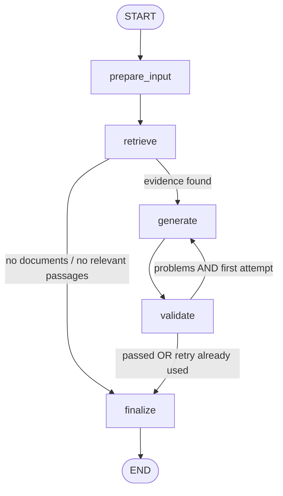
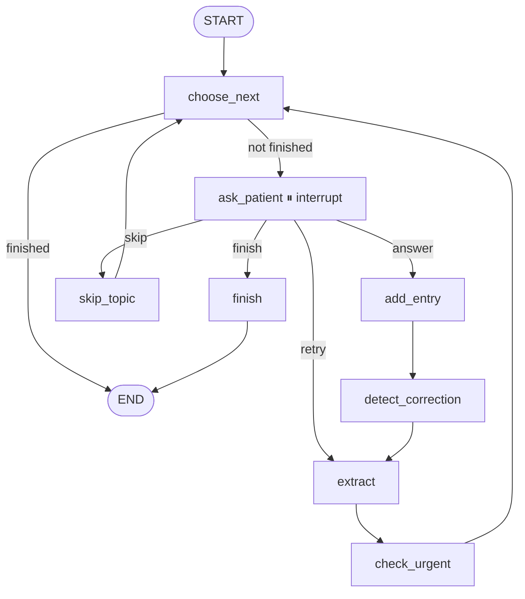
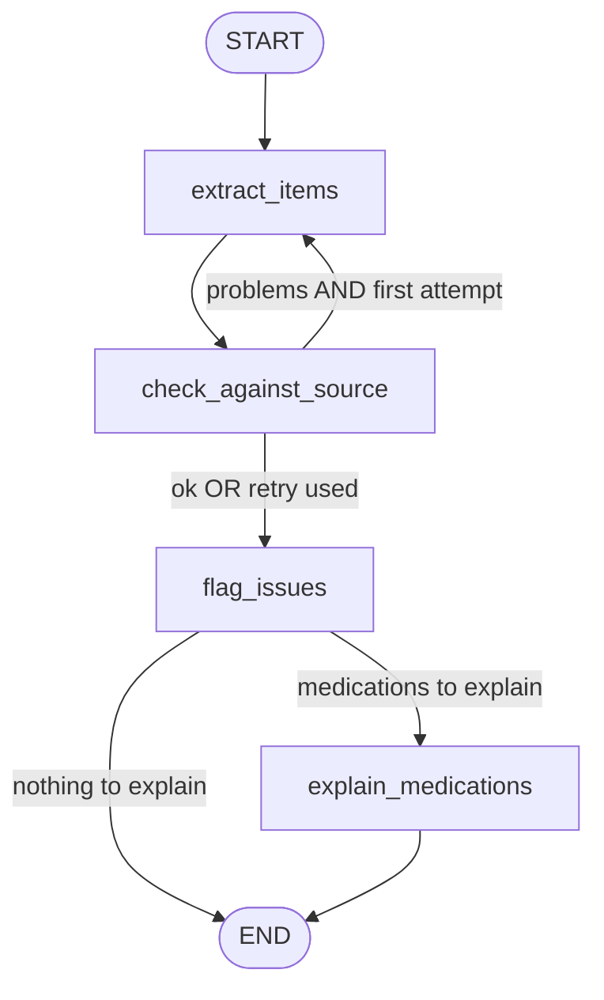

# LangGraph in the patient assistant: a step-by-step guide

This guide explains, from zero, how LangGraph is used in this project. Each step has two parts:

- **The idea**: what the LangGraph concept is, in plain words.
- **In our project**: where it is in the code and why we did it that way.

The steps follow the work log: Week 7 (lab results), Weeks 8–9 (symptom intake), Week 10 (doctor's
instructions and medications), Week 11 (API). The last section is an interview cheat sheet.

> Run everything in **demo mode** (no API key) while you learn: `APP_MODE=demo` in `.env`.
> Then `python scripts/show_graphs.py` prints every graph and shows which steps run, in order.

---

## Contents

0. [Setup on your computer](#0-setup-on-your-computer)
1. [The big picture: what LangGraph is (and is not)](#1-the-big-picture)
2. [The five building blocks, with a 20-line example](#2-the-five-building-blocks)
3. [Step 1 — Explanation graph: lab results (Week 7)](#3-step-1--explanation-graph-week-7)
4. [Step 2 — Intake graph: one question at a time (Week 8)](#4-step-2--intake-graph-week-8)
5. [Step 3 — Pausing and saving: interrupt + checkpointer (Week 9)](#5-step-3--pausing-and-saving-week-9)
6. [Step 4 — Checklist graph with a graph inside a graph (Week 10)](#6-step-4--checklist-graph-week-10)
7. [Step 5 — The same graphs behind an API (Week 11)](#7-step-5--api-week-11)
8. [How the graphs are tested](#8-how-the-graphs-are-tested)
9. [Interview cheat sheet](#9-interview-cheat-sheet)
10. [Glossary](#10-glossary)

---

## 0. Setup on your computer

Windows PowerShell, inside the project folder (the one with `app.py`):

```powershell
Remove-Item -Recurse -Force .venv          # only if you copied an old .venv from another project
python -m venv .venv
Set-ExecutionPolicy -Scope Process -ExecutionPolicy RemoteSigned
.venv\Scripts\Activate.ps1
python -m pip install -r requirements.txt pytest
copy .env.example .env                    # leave OPENAI_API_KEY empty = demo mode

python -m streamlit run app.py            # the app      -> http://localhost:8501
python scripts/show_graphs.py             # learn: diagrams + step-by-step traces
python -m pytest -q                       # all tests (132)
python -m uvicorn api:app --reload        # the API      -> http://127.0.0.1:8000/docs
```

A `.venv` folder must always be created fresh in the project. It stores the absolute path where it was
made, so copying it from another project breaks it.

---

## 1. The big picture

**The idea.** An AI feature is rarely "one prompt → one answer". In a medical assistant, you need to:

- prepare and check the input *before* calling the model,
- search the knowledge base,
- skip the model entirely when there is no evidence,
- check the model's answer and **retry once** if it fails,
- **wait for the patient** between questions, possibly for days,
- remember where the conversation was, even after the app restarts.

You can write all that with `if`s and `while` loops, but it quickly turns into nested conditions that are
hard to read, test and debug. **LangGraph** lets you describe the program as a **graph**:

- **nodes** = steps (plain Python functions),
- **edges** = which step comes next,
- **state** = the shared data the steps read and update.

LangGraph then runs the graph, can **stream** each step as it happens, can **pause** in the middle, and can
**save** the state after every step.

**LangChain vs LangGraph.** Both come from the same company, but they do different jobs:

| | LangChain | LangGraph |
|---|---|---|
| What it gives you | ready-made wrappers: model clients, prompt templates, retrievers, loaders | control of the **flow**: steps, branches, loops, retries, pauses, saved state |
| Used here? | **No** | **Yes** |
| Why | we already call the OpenAI SDK and Chroma directly; the code works and is tested | the flow (retry, branching, waiting for the patient) is exactly what LangGraph is for |

LangGraph does **not** need LangChain. Our nodes are ordinary Python functions that call
`provider.explain(...)` (OpenAI SDK) and `store.query(...)` (Chroma).

---

## 2. The five building blocks

Here is a complete, runnable toy graph. Save it as `toy.py` and run `python toy.py`.

```python
from typing import TypedDict
from langgraph.graph import StateGraph, START, END

class State(TypedDict, total=False):        # 1. STATE: the shared data
    number: int
    attempts: int
    result: str

def double(state: State) -> dict:           # 2. NODE: a function (state) -> partial update
    return {"number": state["number"] * 2, "attempts": state.get("attempts", 0) + 1}

def finish(state: State) -> dict:
    return {"result": f"done: {state['number']} after {state['attempts']} steps"}

def is_big_enough(state: State) -> str:     # 4. ROUTER: returns the name of the next node
    return "finish" if state["number"] >= 10 else "double"

g = StateGraph(State)
g.add_node("double", double)
g.add_node("finish", finish)
g.add_edge(START, "double")                 # 3. EDGE: always go from A to B
g.add_conditional_edges("double", is_big_enough, ["double", "finish"])   # 4. CONDITIONAL EDGE (here a loop)
g.add_edge("finish", END)
graph = g.compile()                         # 5. COMPILE, then invoke / stream

print(graph.invoke({"number": 3}))          # {'number': 12, 'attempts': 2, 'result': 'done: 12 after 2 steps'}
for step in graph.stream({"number": 3}, stream_mode="updates"):
    print(step)                             # {'double': {...}}, {'double': {...}}, {'finish': {...}}
print(graph.get_graph().draw_mermaid())     # a diagram you can paste into https://mermaid.live
```

The rules to remember:

1. **State** is a `TypedDict`. A node returns only the keys it changes. LangGraph merges them into the state.
   By default a key is **overwritten**. A *reducer* (e.g. `Annotated[list, operator.add]`) appends instead.
   We don't need reducers here.
2. **Node** = `def step(state) -> dict`. Keep nodes small and boring: one responsibility each.
3. **Edge** = fixed order. `START` and `END` are the entry and exit.
4. **Conditional edge** = a router function reads the state and returns the next node's name. Loops are just
   conditional edges that point backwards.
5. **Compile** checks the graph and gives you an object with `invoke` (run to the end), `stream` (yield each
   step), and `get_state` / `update_state` (when a checkpointer is used).

Two more ideas you will meet below: the **runtime context** (Step 1) and **interrupt + checkpointer** (Step 3).

---

## 3. Step 1 — Explanation graph (Week 7)

**File:** `intake_assistant/graphs/explain_graph.py` · **Used by:** "Во время приёма → 💡 Объяснить", the API's `/explain`,
and (as a subgraph) the checklist graph.



### What each node does

| Node | What it does | Why it is a separate step |
|---|---|---|
| `prepare_input` | Builds the search query. Parses lab lines into **name, value, unit, interval**: each one is an exact substring of the document. Flags a **missing interval** or an **unrecognised unit** as a question for the doctor. | These checks are deterministic and happen **before** any model call, so the model can never "fill in" a missing interval. |
| `retrieve` | Searches Chroma for supporting passages (`rag.qa.retrieve`). | Its result decides whether the model is called at all. |
| `generate` | One call: `provider.explain(...)` (OpenAI SDK, or offline demo rules). On a retry it also sends `feedback`: the list of problems from the last validation. | Isolates the only non-deterministic, paid step. |
| `validate` | Runs the existing grounding checks: quotes must be verbatim in the patient's document, citations must point to retrieved passages, no personal verdicts ("ваш результат понижен"), no diagnoses, no numbers absent from the sources. Writes a `problems` list. | Validation is its own step, so a router can decide what happens next. |
| `finalize` | Builds the three-part `Explanation`: (1) what the document says, (2) general background from sources, (3) what to ask the doctor. | One place that assembles the output. |

### The two routers (this is the "logic" of the graph)

```python
def route_after_retrieve(state):          # no evidence -> do NOT call the model
    return "generate" if state.get("relevant") else "finalize"

def route_after_validate(state):          # one regeneration, then stop
    if state.get("problems") and state.get("attempts", 0) < MAX_ATTEMPTS:   # MAX_ATTEMPTS = 2
        return "generate"
    return "finalize"
```

If validation fails twice, the unsupported parts are removed (or flagged), and the explanation says so
("Проверка источников не пройдена и после повторной генерации…"). If there is no valid citation at all, the
patient gets "no supporting sources found — ask your doctor" instead of an unverified explanation.

### Runtime context: where the OpenAI client and Chroma live

The **state** should only hold data that changes while the graph runs. The model client and the
vector store are *dependencies*, not data, so they go in the **runtime context**:

```python
@dataclass
class ExplainContext:
    provider: Any          # OpenAIProvider or DemoProvider
    store: Any             # Chroma DocumentStore
    top_k: int = 4
    min_relevance: float = 0.3
    is_demo: bool = False

g = StateGraph(ExplainState, context_schema=ExplainContext)

def retrieve(state, runtime: Runtime[ExplainContext]):     # a node that needs the context
    ctx = runtime.context
    ...

explain_graph.invoke({"item": item, "focus": "Ферритин"}, context=ExplainContext(provider, store))
```

This keeps the state serialisable (important in Step 3) and makes testing easy: the tests pass a fake provider.

### Try it

```powershell
python scripts/show_graphs.py
```

Section 1 prints: `prepare_input → retrieve → generate → validate → finalize`. For a test with no documents
you would see `prepare_input → retrieve → finalize`: the model is never called.

---

## 4. Step 2 — Intake graph (Week 8)

**File:** `intake_assistant/graphs/intake_graph.py` · **Used by:** "До приёма → Рассказ о симптомах", the API's `/intake/...`.

The intake is a **loop**: ask → receive → process → choose the next question → ask…



| Node | What it does |
|---|---|
| `choose_next` | Picks the next uncovered topic in a fixed order (main concern → onset → progression → …). Deterministic, so it never asks a diagnostic question. |
| `ask_patient` | **Pauses** the graph and waits for the patient (Step 3 explains how). |
| `add_entry` | Saves the answer as a new entry `E1, E2…`, linked to the question it answers. |
| `detect_correction` | If the answer starts like a correction ("Поправка: …", "на самом деле…"), links it to the earlier entry (`corrects_entry_id`). **Nothing is overwritten**: the original wording stays in the record, and the summary uses the corrected information. |
| `extract` | One model call: turns all entries into structured facts. A provider error does **not** crash the graph. It is stored in `state["error"]`, the entry is kept, and the UI offers "Повторить обработку" (`action=retry`). |
| `check_urgent` | Runs the (demo) urgency rules on every entry. |
| `skip_topic` / `finish` | Small steps for the "Пропустить вопрос" and "Завершить рассказ" buttons. |

**Why the state holds dicts (`intake.model_dump()`) instead of Pydantic objects:** this graph is saved to disk
after every step (Step 3). Plain dicts and strings are always serialisable, so the saved state is safe and
version-independent.

---

## 5. Step 3 — Pausing and saving (Week 9)

This is the most "LangGraph-specific" part, and the one interviewers like most.

### The idea: `interrupt` + checkpointer + thread_id

- `interrupt(value)` inside a node **stops the graph right there** and returns `value` to the caller (here:
  the question to show).
- A **checkpointer** saves the full state after every step. We use `SqliteSaver`, a single SQLite file.
- A **thread_id** names one conversation. We use the appointment record's id, so each patient record has its own saved conversation.
- To continue, you call the graph again with `Command(resume=reply)`. Inside the paused node,
  `interrupt(...)` now **returns the reply**, and the graph continues from that exact point.

```python
def ask_patient(state):
    reply = interrupt({"question": state.get("question"), "slot": state.get("slot")})   # ⏸ pause here
    return {"reply": reply}                                                             # ▶ resumes here

graph = build_intake_graph(checkpointer=SqliteSaver(sqlite3.connect("…/intake_graph_checkpoints.sqlite")))
config = {"configurable": {"thread_id": record.id}}

graph.invoke({"intake": {...}}, config)                         # runs until the first question, then pauses
graph.get_state(config).interrupts[0].value                     # -> {"question": "Что вас беспокоит…", ...}
graph.invoke(Command(resume={"action": "answer", "text": "Болит голова"}), config)   # continue
```

Because the state is on disk, you can close the browser, restart Streamlit, even restart the computer:
`get_state(config)` still shows the same question, and the next answer continues the same conversation.
The test `test_intake_pauses_resumes_and_survives_restart` proves this by creating a **new** `IntakeFlow`
object on the same file.

### `IntakeFlow`: the bridge between the graph and the app

Streamlit and the API don't talk to the graph directly. They call one method:

```python
result = intake_flow.send(record, {"action": "answer", "text": "..."}, provider, pathway)
```

`send` does three things:

1. **Sync.** The patient can also edit entries in another tab ("Проверка и исправления"). If the record and
   the paused graph differ, `graph.update_state(config, {"intake": ...}, as_node="check_urgent")` replaces the
   graph's copy. This is a *human-in-the-loop edit* of a paused graph. Then the graph pauses again at the question.
2. **Resume** with `Command(resume=reply)`, using `stream(..., stream_mode="updates")` to record which nodes ran
   (`result.trace`, e.g. `ask_patient → add_entry → detect_correction → extract → check_urgent → choose_next → ask_patient ⏸`).
3. **Copy back** the new state into the record (entries, extraction, urgency check) and add the patient's own
   questions to the "questions for the doctor" list.

### Streamlit specifics (good to mention in an interview)

- Streamlit **reruns the whole script on every click**. The graph object is created **once** with
  `@st.cache_resource` (`app.py → _intake_flow`) and shared. One SQLite connection is opened with
  `check_same_thread=False` and protected by a lock, because Streamlit runs sessions in threads.
- The UI shows the question from the record. The graph's job is to decide *what happens* after each answer.

### Privacy

The checkpoint file contains patient text, so it lives next to the records (`data/appointments/`), is
git-ignored, and **"🗑️ Удалить запись" also deletes the record's thread**: `checkpointer.delete_thread(record.id)`
(`IntakeFlow.forget`).

---

## 6. Step 4 — Checklist graph (Week 10)

**File:** `intake_assistant/graphs/checklist_graph.py` · **Used by:** "После приёма → 📋 Составить список дел", the
fictional example, the API's `/checklist`.



| Node | What it does |
|---|---|
| `extract_items` | One model call: split the instructions into items with **action, medication name, dose, frequency, duration, deadline**. On retry, sends the problems as feedback. |
| `check_against_source` | Every item must quote the doctor **verbatim**. Every field must be a verbatim fragment of that quote, otherwise it stays empty and is flagged. Nothing is converted, rounded or completed. |
| `flag_issues` | Ambiguous wording ("в ближайшее время"), missing details (no dose) and contradictions ("2 раза в день" vs "1 раз в день") are flagged, **never resolved**. Issues the patient already marked "Уточнено" stay resolved after a rebuild. |
| `explain_medications` | For each medicine: runs the **explanation graph from Step 1** as a subgraph (what the medicine usually is, from sources). Then a **medication-specific check** (`strip_dosing`) removes any sentence with a dose or schedule the doctor did not write. Unchanged items reuse their saved explanation, so there is no new model call. |

**Graph inside a graph.** `explain_medications` simply calls `explain_graph.invoke(...)`. Reusing a
compiled graph like a function is a normal LangGraph pattern: the explanation logic and its checks exist
in one place only.

In the UI, every medication card has "💊 Что это за лекарство — по источникам": the doctor's words, a short
explanation, the source passages, and questions for the doctor ("Зачем мне назначен «…» и чего ожидать?").

---

## 7. Step 5 — API (Week 11)

**File:** `api.py` (FastAPI). The **same compiled graphs** run behind HTTP, so the Medical.kz website could use
the assistant without Streamlit.

| Endpoint | Graph | Notes |
|---|---|---|
| `POST /intake/sessions` | intake | creates a record, runs to the first question, returns `session_id` |
| `POST /intake/sessions/{id}/reply` | intake | body `{"action": "answer", "text": "..."}` / `skip` / `finish` / `resume` / `retry` |
| `GET` / `DELETE /intake/sessions/{id}` | — | read state / delete record + files + checkpoints |
| `POST /explain` | explanation | `{"kind": "test_result", "text": "...", "focus": "Ферритин"}` |
| `POST /checklist` | checklist | `{"instructions": ["..."], "explain_medications": true}` |

Every response has a `status` (`waiting_for_patient`, `finished`, `answered`, `needs_clarification`, `error`)
and a `trace` with the node names that ran: useful for debugging and a nice thing to show in a demo. Logs
contain node names and error *types* only, never patient text. Errors: invalid body → 422, unknown session → 404,
model/provider failure → 502 with a readable message.

Open `http://127.0.0.1:8000/docs` to try every endpoint in the browser.

---

## 8. How the graphs are tested

`tests/test_graphs.py` (13 tests, all offline, in demo mode or with fake providers):

- **Order of steps**: `stream(..., stream_mode="updates")` gives the node names, and the test asserts the exact path.
  For example, with no documents, `generate` never runs.
- **Retry**: a fake provider that always cites a passage that was never retrieved. The test asserts that `generate`
  ran exactly twice, that the second call received `feedback`, and that the final result is "insufficient evidence".
- **Pause / resume / restart**: two `IntakeFlow` objects on the same SQLite file.
- **Corrections, edits from another tab, provider errors + retry, finish/resume, delete.**
- **Checklist**: verbatim doses, contradictions, medication explanations, the `strip_dosing` check, reuse of explanations.
- **API**: FastAPI `TestClient` for all endpoints.

The original 119 tests still pass unchanged. The public function `explain_item(...)` kept its signature and now
calls the graph inside, so the UI and old tests didn't need to change. This is a safe way to migrate.

---

## 9. Interview cheat sheet

### 30-second pitch

> "During my internship at Medical.kz I built a patient assistant for before, during and after a doctor's
> appointment. It's Python with Streamlit, a RAG pipeline on Chroma with the OpenAI SDK, and LangGraph for the
> workflows. For example, explaining a lab result is a graph: prepare and check the input, retrieve sources, skip
> the model when there's no evidence, generate, validate citations and numbers, and regenerate once if validation
> fails. The symptom intake uses LangGraph's interrupt and a SQLite checkpointer, so the conversation pauses for
> each answer and can be resumed after a restart. Medical safety rules are deterministic code inside the nodes, not
> left to the model."

### Likely questions and answers

**Why LangGraph and not a simple chain or plain Python?**
My flows have branches (no evidence → skip the model), loops (retry after failed validation, the question loop),
and pauses (waiting for the patient). In plain Python that becomes nested `if`s and session flags spread across the
UI. In LangGraph each step is a small testable function, and the flow is explicit, visible as a diagram and
testable by asserting the path of nodes.

**Why not LangChain?**
I didn't need its wrappers. The OpenAI SDK and Chroma code already worked and was tested. LangGraph works with plain
functions, so I only added orchestration and kept full control of prompts and structured outputs.

**What is the state, and why are dependencies in the context?**
The state is a `TypedDict` with the data that changes: query, retrieved passages, attempts, problems, result.
The OpenAI client and the vector store are passed through the runtime context (`context_schema`). That keeps the
state serialisable for checkpointing and makes it easy to inject fakes in tests.

**How does the retry work? Can it loop forever?**
A conditional edge after `validate`: if there are problems and `attempts < 2`, go back to `generate` with the
problems as feedback. Otherwise go to `finalize`. The counter is in the state, so there is at most one regeneration. LangGraph
also has a recursion limit as a safety net.

**How do you prevent hallucinations?**
Deterministic checks, not prompts alone: values and units must be exact substrings of the patient's document;
citations must point to retrieved chunk ids; quotes must be verbatim in the cited chunk; numbers in AI text must
exist in the sources; sentences that judge the patient's own result or sound diagnostic are removed. No relevant
passages → the model isn't called and the app says so.

**What does `interrupt` do, and what is a checkpointer?**
`interrupt` pauses a node and returns a value to the caller. The checkpointer saves the state after each step under
a `thread_id`. Resuming with `Command(resume=…)` continues the same node, where `interrupt` now returns the patient's
answer. I used `SqliteSaver`, so a conversation survives an app restart. In production I'd use the Postgres checkpointer.

**How did you integrate it with Streamlit, which reruns on every click?**
The compiled graph is a cached resource, created once. Each click calls one method that syncs the record into the
paused graph (`update_state`), resumes it, and copies the new state back. One SQLite connection with
`check_same_thread=False` and a lock, because Streamlit uses threads.

**What if the user edits an earlier answer in another tab?**
Before resuming, I compare the record with the graph state and call `update_state(..., as_node="check_urgent")`, so
the paused graph continues from the edited data. Corrections typed in the chat are stored as new entries linked to
the old one, so nothing is overwritten.

**How do you test a graph?**
Stream with `stream_mode="updates"` and assert the sequence of nodes. Use fake providers for failure cases, for example
a provider that always cites a non-retrieved passage, to prove the retry runs exactly once. And restart tests with two
`IntakeFlow` objects on the same file.

**Patient data and privacy?**
Records and checkpoints are stored locally and separately from the knowledge base. Deleting a record deletes its
files and its checkpoint thread. Logs contain node names and error types, never patient text. In live mode, text goes to
OpenAI, and the UI says so.

**What would you improve next?**
A Postgres checkpointer and authentication for a multi-user deployment. Evaluation on a labelled set of real
(anonymised) lab reports. LangSmith or OpenTelemetry tracing. Running medication explanations in parallel (LangGraph
`Send`). Clinician-validated urgency rules and sources.

### Honest limitations (say them before they ask)

- Prototype, not clinically validated, and the demo documents are written by me and labelled "ДЕМО".
- In demo mode a "retry" produces the same output (rules are deterministic). The feedback loop matters in live mode.
- Correction detection is a simple keyword rule, and the model then uses the `corrects` link.

---

## 10. Glossary

| Term | Meaning |
|---|---|
| **StateGraph** | The graph builder: you add nodes and edges, then `compile()`. |
| **State** | The shared data (`TypedDict`) passed between nodes. Nodes return partial updates. |
| **Node** | A step: a Python function `state → dict`. |
| **Edge / conditional edge** | Fixed next step / a router function that chooses the next step. |
| **START / END** | Special entry and exit nodes. |
| **Runtime context** | Per-run dependencies (model client, vector store) available to nodes as `runtime.context`, not saved in the state. |
| **invoke / stream** | Run to the end / yield results step by step (`stream_mode="updates"` → `{node: update}`). |
| **Checkpointer** | Saves state after each step (`InMemorySaver`, `SqliteSaver`, Postgres…). Required for `interrupt`. |
| **thread_id** | Name of one saved conversation. Here, the appointment record id. |
| **interrupt / Command(resume=…)** | Pause inside a node / continue it with a value. |
| **get_state / update_state** | Read / edit the saved state of a thread from outside the graph. |
| **Subgraph** | A compiled graph used inside another graph's node. Here, the explanation graph inside the checklist graph. |
| **RAG** | Retrieval-Augmented Generation: find passages first, then let the model answer only from them. |
| **Grounding check** | Code that verifies the model's output against the sources (verbatim quotes, valid citations, numbers). |
